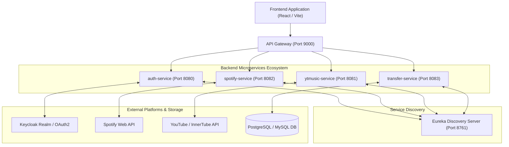

# 🎵 PlaySwap Microservices Server Engine

Welcome to the backend server engine of **PlaySwap** — a high-performance, microservices-based music playlist migration platform that enables users to analyze and seamlessly transfer playlists between **Spotify** and **YouTube Music**.

---

## 📐 System Architecture



---

## 📑 Microservices Overview

| Microservice | Port | Description & Responsibilities | Key Endpoints |
| :--- | :--- | :--- | :--- |
| **`eureka-server`** | `8761` | Service Registry & Discovery server for dynamic registration and load balancing. | `GET /` (Eureka Dashboard) |
| **`api-gateway`** | `9000` | Central API entry point. Handles JWT validation, CORS deduplication, Actuator metrics, and path routing. | `/api/spotify/**`<br>`/api/ytmusic/**`<br>`/api/transfer/**`<br>`/api/history/**` |
| **`auth-service`** | `8080` | Manages Keycloak realm authentication, OAuth2 token exchanges, and token delegation. | `/api/auth/**`<br>`/api/me/**` |
| **`spotify-service`** | `8082` | Spotify Web API client. Manages user playlists, tracks fetching (`/items`), fuzzy track search, rate-limit retries, and playlist creation/insertion. | `GET /api/spotify/playlists`<br>`GET /api/spotify/playlists/{id}/tracks`<br>`POST /api/spotify/analyze-track`<br>`POST /api/spotify/playlists/create`<br>`POST /api/spotify/playlists/{id}/add-tracks` |
| **`ytmusic-service`** | `8081` | YouTube Music & InnerTube API client. Handles user playlists, recursive item fetching, multi-tier track search (songs/videos), playlist creation, and video insertion. | `GET /api/ytmusic/playlists`<br>`GET /api/ytmusic/playlists/{id}/tracks`<br>`POST /api/ytmusic/analyze-track`<br>`POST /api/ytmusic/playlists/create`<br>`POST /api/ytmusic/playlists/{id}/add-tracks` |
| **`transfer-service`** | `8083` | Core transfer engine. Coordinates playlist analysis, song mapping cache lookups, end-to-end execution, and `transfer_history` table persistence. | `POST /api/transfer/analyze`<br>`POST /api/transfer/execute`<br>`GET /api/transfer/history`<br>`GET /api/history` |

---

## ✨ Summary of Implementation & Features

### 1. Spotify Playlist & Track Pipeline
- **User-Created Playlist Filtering**: `GET /v1/me/playlists?limit=50` items are filtered against the current logged-in user's Spotify ID (`owner.id`). Only user-owned playlists are returned.
- **Robust Track Endpoint Pipeline**: Primary track fetching uses Spotify's `/playlists/{id}/items?limit=100&market=from_token` endpoint. Built-in fallbacks handle `/items` without market param, legacy `/tracks`, and direct playlist inspection (`GET /playlists/{id}`).
- **Track Normalization & Relinking**: Extracts track metadata from wrapped (`track`, `item`) and unwrapped objects. Resolves relinked track IDs via `linked_from.id` and `uri` (`spotify:track:...`).

### 2. YouTube Music Playlist & Track Pipeline
- **User-Owned Playlists**: Calls YouTube Data API `v3/playlists?mine=true` to retrieve user playlists.
- **Recursive Item Pagination**: `getPlaylistTracks()` uses page tokens (`nextPageToken`) to recursively fetch all playlist tracks via `v3/playlistItems`.

### 3. Dynamic Cross-Platform Analysis Engine
- **Spotify $\rightarrow$ YouTube Music**: Searches YouTube Music using InnerTube multi-tier candidate search (Tier 2: Songs, Tier 3: Videos, Tier 4: YouTube Data API fallback) and computes confidence scores.
- **YouTube Music $\rightarrow$ Spotify**: Searches Spotify Web API (`POST /api/spotify/analyze-track`) via `q={title} {artist}`, cleaning text and matching fuzzy token overlap scores.
- **Song Mapping Cache**: Successful matches are saved in `song_mappings` database table to enable instant, zero-latency caching for duplicate track lookups.

### 4. End-to-End Playlist Transfer Execution Engine
- **Target Playlist Creation**: Automatically creates target private playlists on destination platforms (e.g., `"Playlist Name (PlaySwap)"`).
- **Batch Track Population**:
  - **Spotify**: Formats track URIs (`spotify:track:XXXX`) and inserts tracks in batches of 100 via `POST /playlists/{id}/tracks`.
  - **YouTube Music**: Inserts video items via `POST /playlistItems?part=snippet`.
- **Database History Persistence**: Automatically logs every completed playlist transfer to the **`transfer_history`** database table and exposes history via `GET /api/transfer/history` and `GET /api/history`.

### 5. Spotify HTTP 429 Rate-Limit Retry Backoff
- Implemented `SpotifyRetryUtil.java` ([SpotifyRetryUtil.java](file:///c:/Users/SOOQ%20ELASER/OneDrive/Desktop/javaDev/EverythingJava/learninJavaSpringBoot/playswap/server/spotify-service/src/main/java/com/justice/spotify_service/util/SpotifyRetryUtil.java)) in `spotify-service`.
- Catches `WebClientResponseException.TooManyRequests` (HTTP 429), inspects `Retry-After` headers, and applies 5-attempt exponential backoff with randomized jitter (2s to 15s delay).

### 6. Uniform Global Exception Handling
- Integrated `@RestControllerAdvice` global exception handling with a standardized `ApiErrorResponse` DTO across microservices.
- Ensures all API errors (bad requests, unauthorized calls, unhandled runtime exceptions) return consistent, structured JSON responses (`timestamp`, `status`, `error`, `message`, `path`).

### 7. YouTube Data API Quota Safeguard
- Added a quota monitoring safeguard in `YoutubeApiClient.java` (`ytmusic-service`).
- Automatically calculates estimated quota units (50 units per inserted track) and emits prominent log warnings when processing large playlist transfers to prevent unexpected quota exhaustion.

### 8. Production Orchestration & Docker Compose
- Created `docker-compose.prod.yml` ([`docker-compose.prod.yml`](file:///c:/Users/SOOQ%20ELASER/OneDrive/Desktop/javaDev/EverythingJava/learninJavaSpringBoot/playswap/server/docker-compose.prod.yml)) orchestrating all 6 microservices alongside PostgreSQL with automated health checks (`pg_isready`, `/actuator/health`) and dynamic environment variable injection.
- Exposed Spring Boot Actuator endpoints (`/actuator/health`, `/actuator/info`, `/actuator/metrics`, `/actuator/prometheus`) across all microservices for Docker/Kubernetes health probes.
- Database indexing script [`schema_indexes.sql`](file:///c:/Users/SOOQ%20ELASER/OneDrive/Desktop/javaDev/EverythingJava/learninJavaSpringBoot/playswap/server/transfer-service/src/main/resources/schema_indexes.sql) provides optimized indexes for `transfer_sessions`, `transfer_jobs`, `transfer_items`, `transfer_history`, and `song_mappings`.

---

## 🛠 Database Indexing Script (`schema_indexes.sql`)

Apply these indexes on your database for optimal performance:

```sql
CREATE INDEX IF NOT EXISTS idx_transfer_sessions_user_created ON transfer_sessions(user_id, created_at DESC);
CREATE INDEX IF NOT EXISTS idx_transfer_jobs_session_id ON transfer_jobs(session_id);
CREATE INDEX IF NOT EXISTS idx_transfer_items_job_id_status ON transfer_items(job_id, status);
CREATE INDEX IF NOT EXISTS idx_transfer_history_user_created ON transfer_history(user_id, created_at DESC);
CREATE INDEX IF NOT EXISTS idx_transfer_history_session_id ON transfer_history(session_id);
CREATE INDEX IF NOT EXISTS idx_song_mappings_lookup ON song_mappings(source_platform, source_track_id, destination_platform);
```

---

## 🚀 How to Run & Verify

### 1. Startup Order
1. **Eureka Discovery Server** (`eureka-server` - Port 8761)
2. **API Gateway** (`api-gateway` - Port 9000)
3. **Auth Service** (`auth-service` - Port 8080)
4. **Spotify Service** (`spotify-service` - Port 8082)
5. **YTMusic Service** (`ytmusic-service` - Port 8081)
6. **Transfer Service** (`transfer-service` - Port 8083)

### 2. Compilation Verification
Run Maven compile in any service directory:
```bash
mvnw.cmd compile
```

---

## ⚡ Key API Endpoints Reference

### 1. Analyze Playlists
```http
POST http://localhost:9000/api/transfer/analyze
X-User-Id: {user_id}
Content-Type: application/json

{
  "sourcePlatform": "SPOTIFY",
  "targetPlatform": "YTMUSIC",
  "playlistIds": ["37i9dQZF1DXcBWIGoYBM5M"]
}
```

### 2. Execute Transfer
```http
POST http://localhost:9000/api/transfer/execute
X-User-Id: {user_id}
Content-Type: application/json

{
  "sessionId": "{session_uuid}"
}
```

### 3. Get Transfer History
```http
GET http://localhost:9000/api/transfer/history
X-User-Id: {user_id}
```
*(Also accessible at `GET http://localhost:9000/api/history`)*
